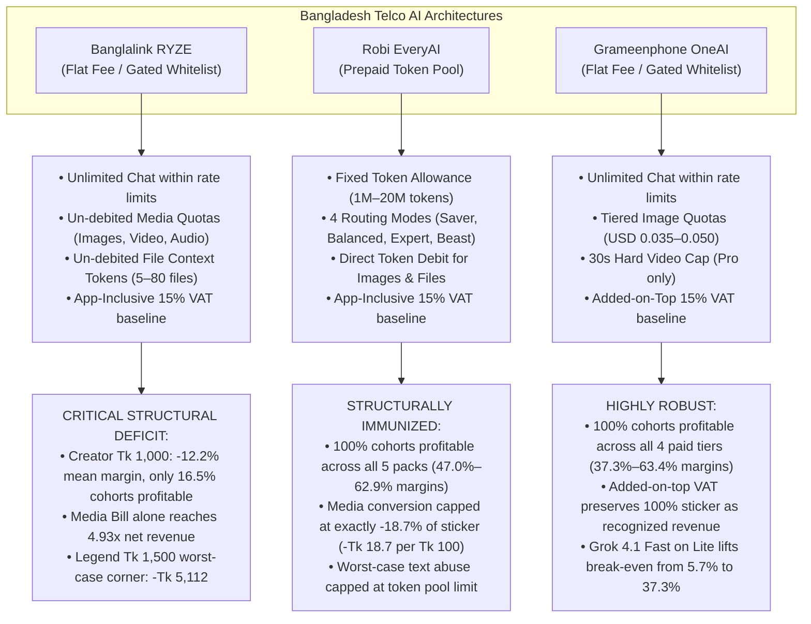
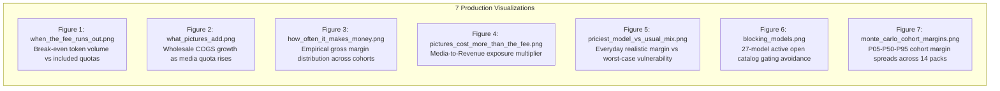

# Bangladeshi Telco AI Hub Unit-Economics Simulator

> **Technical & Methodological Architecture Reference for AI Agents & Auditors**  
> **Repository Root:** [`c:/Users/User/Downloads/Simulation BD Telco`](file:///c:/Users/User/Downloads/Simulation%20BD%20Telco)  
> **Binding Specification:** [`bd_info.md`](file:///c:/Users/User/Downloads/Simulation%20BD%20Telco/bd_info.md)  
> **Research & Tariff Anchor Date:** 6 October 2026 (Bangladesh Bank FX, BTRC tariff guidelines, published provider API rate cards)

---

## Table of Contents
1. [Executive Summary & Strategic Verdict](#1-executive-summary--strategic-verdict)
2. [Commercial Packaging & Modality Architectures](#2-commercial-packaging--modality-architectures)
3. [Managerial Accounting & Unit Economics Mathematics](#3-managerial-accounting--unit-economics-mathematics)
4. [Methodology 1: Deterministic Exhaustive Factor Grid](#4-methodology-1-deterministic-exhaustive-factor-grid)
5. [Methodology 2: Continuous Empirical Monte Carlo Cohort Simulation](#5-methodology-2-continuous-empirical-monte-carlo-cohort-simulation)
6. [Methodology 3: Sensitivity & Common Random Numbers (CRN) Stress Testing](#6-methodology-3-sensitivity--common-random-numbers-crn-stress-testing)
7. [Master Upstream Price Book & Model Catalog](#7-master-upstream-price-book--model-catalog)
8. [Repository Architecture & Codebase Walkthrough](#8-repository-architecture--codebase-walkthrough)
9. [Output Data Dictionary & Visual Artifacts](#9-output-data-dictionary--visual-artifacts)
10. [Independent Verification Suite (`tests/`)](#10-independent-verification-suite-tests)
11. [Low-Memory Host Engineering & Agent Gotchas](#11-low-memory-host-engineering--agent-gotchas)
12. [Operational Quickstart & Extension Recipes](#12-operational-quickstart--extension-recipes)

---

## 1. Executive Summary & Strategic Verdict

In late 2026, Bangladesh's three major Mobile Network Operators (MNOs)—**Banglalink (RYZE AI Hub)**, **Robi Axiata (EveryAI)**, and **Grameenphone (OneAI)**—launched consumer retail AI subscription products. Each operator adopted a fundamentally different commercial architecture:



### Core Strategic Takeaways for Technical Auditors
1. **Banglalink's Creator Plan (Tk 1,000) is a structural loss-leader:** Under direct app/MFS checkout (absorbing 15% VAT inside sticker, leaving `813.04 BDT` net recognized), realistic everyday usage results in a **`-12.2%` mean gross margin** (`-Tk 99` everyday loss per user) and only **`16.5%` profitable cohorts**. If power users consume their full media allowance (272 images, 65 video clips, 389 audio tracks), the wholesale media bill alone is **`4.93×` net subscription revenue**.
2. **Un-debited File Uploads are an overlooked vulnerability:** Banglalink grants `5` to `80` file uploads that do *not* debit tokens. Because multi-turn conversations re-send attached files as un-cached input tokens, Legend's 80 files inject up to `1.6M` uncached input context tokens, deepening its worst-case vulnerability corner to **`-Tk 5,112`** (exceeding Creator's `-Tk 4,902`).
3. **Robi's Token Debit Architecture completely immunizes wholesale exposure:** By deducting image and file generation directly from the prepaid token pool at the plan's implied retail rate, Robi caps wholesale media exposure identically across all 5 packs at **`1.23×` net revenue** (**`-Tk 18.7` per Tk 100 sticker**, representing the statutory 15% VAT + 6.5% BTRC/SOF wedge). All 5 Robi packs maintain **`100.0%` cohort profitability** (`47.0%` to `62.9%` mean gross margins).
4. **Grameenphone's Added-On-Top VAT and Conservative Routing preserve strong margins:** GP charges 15% VAT on top of the sticker price (`Cash = Sticker * 1.15`, `Recognized = Sticker`). Combined with mapping `Grok 4.1 Fast Non-Reasoning` (`$0.20/$0.50`) to Lite and capping video at 30 seconds on Pro, all 4 paid GP tiers achieve **`100.0%` cohort profitability** (`37.3%` to `63.4%` mean gross margins).

---

## 2. Commercial Packaging & Modality Architectures

### A. Summary Comparison Matrix Across All 14 Packs

| Operator | Plan Name | Sticker Price | VAT Mode | Net Recognized | Allowance Structure | Media Quotas | Files Quota |
|---|---|---:|---|---:|---|---|---:|
| **Banglalink** | Basic | ৳100 | Inclusive | ৳81.30 | Unlimited Chat (4 models) | 5 img, 0 vid, 0 aud | 5 files |
| **Banglalink** | Advanced | ৳300 | Inclusive | ৳243.91 | Unlimited Chat (5 models) | 15 img, 0 vid, 0 aud | 15 files |
| **Banglalink** | Pro | ৳500 | Inclusive | ৳406.52 | Unlimited Chat (10 models) | 54 img, 13 clips (65s), 0 aud | 25 files |
| **Banglalink** | Creator | ৳1,000 | Inclusive | ৳813.04 | Unlimited Chat (24 models) | 272 img, 65 clips (325s), 389 aud | 30 files |
| **Banglalink** | Legend | ৳1,500 | Inclusive | ৳1,219.57 | Unlimited Chat (24 models) | 272 img, 65 clips (325s), 389 aud | 80 files |
| **Robi** | Pack 1 | ৳99 | Inclusive | ৳80.49 | 1,000,000 Tokens (Saver, Balanced) | Deducts from Token Pool | Deducts from pool |
| **Robi** | Pack 2 | ৳149 | Inclusive | ৳121.14 | 2,000,000 Tokens (Saver, Balanced) | Deducts from Token Pool | Deducts from pool |
| **Robi** | Pack 3 | ৳349 | Inclusive | ৳283.75 | 5,000,000 Tokens (Saver, Balanced, Expert) | Deducts from Token Pool | Deducts from pool |
| **Robi** | Pack 4 | ৳599 | Inclusive | ৳487.01 | 10,000,000 Tokens (All 4 Modes) | Deducts from Token Pool | Deducts from pool |
| **Robi** | Pack 5 | ৳999 | Inclusive | ৳812.23 | 20,000,000 Tokens (All 4 Modes) | Deducts from Token Pool | Deducts from pool |
| **Grameenphone**| Free | ৳0 | N/A | ৳0.00 | Unlimited Chat (2 models) | 0 img, 0 vid | 0 files |
| **Grameenphone**| Student | ৳71 | Added-on-top | ৳71.00 | Unlimited Chat (2 models) | 10 img (\$0.035), 0 vid | 0 files |
| **Grameenphone**| Lite | ৳99 | Added-on-top | ৳99.00 | Unlimited Chat (4 models) | 30 img (\$0.035), 0 vid | 0 files |
| **Grameenphone**| Plus | ৳299 | Added-on-top | ৳299.00 | Unlimited Chat (8 models) | 50 img (\$0.045), 0 vid | 0 files |
| **Grameenphone**| Pro | ৳799 | Added-on-top | ৳799.00 | Unlimited Chat (6 frontier) | 100 img (\$0.050), 30s vid | 0 files |

---

## 3. Managerial Accounting & Unit Economics Mathematics

All formulas operate at the grain of **monthly totals per subscriber** ($i \in [1, N]$), aggregated across cohorts of $N = 100$ users.

### A. Top-Line Revenue & Per-Operator VAT Modes

Under Bangladesh taxation and telco billing channels:
* **Added-on-top (`gp_vat_mode = "added_on_top"`):** Subscribers pay 15% VAT on top of the catalog price during checkout. The operator recognizes 100% of the sticker price as gross revenue:
  $$\text{CashCollected} = \text{PriceBDT} \times 1.15, \quad \text{RecognizedBDT} = \text{PriceBDT}$$
* **Inclusive (`bl_vat_mode = "inclusive"`, `robi_vat_mode = "inclusive"`):** Subscribers pay the exact sticker price via digital channels (bKash/Nagad/Cards/In-App). The operator must remit 15% VAT from the collected proceeds:
  $$\text{CashCollected} = \text{PriceBDT}, \quad \text{RecognizedBDT} = \frac{\text{PriceBDT}}{1.15} \approx 0.86957 \times \text{PriceBDT}$$
* **Talktime Recharge (`vat_mode = "sticker_is_revenue"`):** When users subscribe using pre-existing talktime airtime balances, VAT and Supplementary Duty (SD) were already deducted at the point of airtime recharge:
  $$\text{RecognizedBDT} = \text{PriceBDT}$$
* **Channel Split (`vat_mode = "mixed_50_50"`):** Assumes 50% digital checkout and 50% airtime balance:
  $$\text{RecognizedBDT} = \text{PriceBDT} \times \left(0.50 + \frac{0.50}{1.15}\right) \approx 0.93478 \times \text{PriceBDT}$$

### B. Statutory Deductions & Net Recognized Revenue

From gross recognized revenue, statutory and payment charges are deducted:
1. **BTRC Gross Revenue Share:** $5.5\%$
2. **Social Obligation Fund (SOF):** $1.0\%$
3. **Combined Statutory Deduction:** $6.5\%$
4. **Merchant Discount Rate (MDR):** Baseline $0.0\%$ (Bangla QR MDR removed Oct 2026; swept $1.0\%$ and $1.85\%$ in stress scenarios).
5. **Churn & Refund Reserve:** Baseline $0.0\%$ (swept up to $3.0\%$).

$$\text{NetRevBDT} = \text{RecognizedBDT} \times (1 - 0.055 - 0.010) \times (1 - \text{MDR}) \times (1 - \text{Churn})$$

For an app-inclusive plan at baseline ($\text{MDR}=0, \text{Churn}=0$):
$$\text{NetRevBDT} = \frac{\text{PriceBDT}}{1.15} \times 0.935 = \frac{0.935}{1.15} \times \text{PriceBDT} \approx 0.81304 \times \text{PriceBDT}$$

### C. Upstream API Token Pricing with KV-Cache Reuse

Given a user's input-to-output token ratio $r_{io} = \frac{\text{InputTokens}}{\text{OutputTokens}}$, cache hit rate $h \in [0, 1]$, and cache write share $w \in [0, 1 - h]$:

1. **Input Token Weight & Output Token Weight:**
   $$\alpha_{in} = \frac{r_{io}}{r_{io} + 1}, \quad \alpha_{out} = \frac{1}{r_{io} + 1}$$
2. **Effective Input Rate (USD per 1M tokens):**
   $$P_{in}(m) = (1 - h - w) \cdot P_{miss}(m) + h \cdot P_{read}(m) + w \cdot P_{write}(m)$$
3. **Blended Token Rate (USD per 1M tokens):**
   $$P_{blended}(m) = \alpha_{in} \cdot P_{in}(m) + \alpha_{out} \cdot P_{out}(m)$$
4. **Pure Input Context Rate (USD per 1M tokens, used for file attachments):**
   $$P_{in\_token}(m) = P_{in}(m) + \frac{\text{InfraUSD}}{10^6}$$

### D. Token Pool Operator Accounting (Robi EveryAI)

Robi enforces a prepaid monthly token budget $B_p$. Standalone images deduct directly from the token pool at the pack's implied retail rate:

1. **Implied Retail Token Rate:**
   $$R_{tok} = \frac{\text{PriceBDT}_p}{B_p} \quad (\text{BDT per token})$$
2. **Token Pool Debit per Generated Image:**
   $$\text{TokensPerImage}_p = \frac{\text{ImageUSD} \times \text{fx\_buy}}{R_{tok}} = \frac{\text{ImageUSD} \times \text{fx\_buy} \times B_p}{\text{PriceBDT}_p}$$
3. **Token Usage Allocation:**
   Given user token budget utilization $u \in [0, 1]$ and image conversion fraction $f_{img} \in [0, 1]$:
   $$\text{TotalUsedTokens} = u \times B_p$$
   $$\text{ImageTokens} = f_{img} \times \text{TotalUsedTokens}, \quad \text{TextTokens} = (1 - f_{img}) \times \text{TotalUsedTokens}$$
   $$\text{ImageCount} = \frac{\text{ImageTokens}}{\text{TokensPerImage}_p} = \frac{f_{img} \cdot u \cdot \text{PriceBDT}_p}{\text{ImageUSD} \times \text{fx\_buy}}$$
4. **Breakage & Inactive Subscriptions:**
   $$\text{BreakageBDT} = \text{NetRevBDT} \times (1 - u)$$
5. **COGS & Contribution:**
   $$\text{TextCOGS\_BDT} = \left(\text{TextTokens} \cdot P_{blended} \cdot (1 - d) + \frac{\text{InfraUSD}}{10^6} \cdot \text{TextTokens}\right) \times \text{fx\_buy} \times (1 + r_{tt})$$
   $$\text{MediaCOGS\_BDT} = \text{ImageCount} \times \text{ImageUSD} \times (1 - d) \times \text{fx\_buy} \times (1 + r_{tt})$$
   $$\text{ContributionBDT} = \text{NetRevBDT} - (\text{TextCOGS\_BDT} + \text{MediaCOGS\_BDT})$$

#### Mathematical Proof of the -18.7% Media Spread Invariant
Substitute $\text{ImageCount}$ into $\text{MediaCOGS\_BDT}$ under $d=0, r_{tt}=0$:
$$\text{MediaCOGS\_BDT} = \left(\frac{f_{img} \cdot u \cdot \text{PriceBDT}}{\text{ImageUSD} \cdot \text{fx\_buy}}\right) \times \text{ImageUSD} \times \text{fx\_buy} = f_{img} \cdot u \cdot \text{PriceBDT}$$
At maximum conversion ($f_{img} = 1.0, u = 1.0$):
$$\text{MaxMediaCOGS\_BDT} = \text{PriceBDT}$$
$$\text{ContributionBDT} = \text{NetRevBDT} - \text{PriceBDT} = \left(\frac{0.935}{1.15} - 1.0\right) \times \text{PriceBDT} = -0.186956 \times \text{PriceBDT} \approx \mathbf{-18.7\%}$$
*Conclusion:* Under Robi's token debit mechanism, **media generation can never exceed 1.23× net recognized revenue**, mathematically guaranteeing that worst-case media loss is strictly bounded at `-Tk 18.7` per Tk 100 of subscription sticker.

### E. Gated Whitelist & Flat-Fee Accounting (Banglalink & GP)

Flat subscription plans provide unlimited chat within rate limits and fixed media/file quotas.

1. **Multimodal Wholesale Media Bill:**
   Given generated images $I$, video seconds $V_{sec}$, and audio tracks $A$:
   $$\text{MediaUSD} = (I \cdot P_{img}) + (V_{sec} \cdot P_{vid}) + (A \cdot P_{aud})$$
   $$\text{MediaBDT} = \text{MediaUSD} \times (1 - d) \times \text{fx\_buy} \times (1 + r_{tt})$$
2. **Un-Debited File Context Load (Banglalink):**
   Given file upload fraction $f_{file} \in [0, 1]$ and file quota $F_p$:
   $$\text{FilesUploaded} = f_{file} \times F_p$$
   $$\text{FileContextTokens} = \text{FilesUploaded} \times \text{TokensPerFile}$$
   $$\text{FileBDT} = \left(\text{FileContextTokens} \cdot P_{in\_token} \cdot (1 - d)\right) \times \text{fx\_buy} \times (1 + r_{tt})$$
3. **Room Remaining & Break-Even Token Volume:**
   $$\text{RoomRemainingBDT} = \text{NetRevBDT} - \text{MediaBDT} - \text{FileBDT}$$
   $$\text{BreakEvenChatTokens} = \begin{cases} 0.0 & \text{if } \text{RoomRemainingBDT} \le 0 \\ \frac{\text{RoomRemainingBDT}}{\text{BDTPerChatToken}} & \text{if } \text{RoomRemainingBDT} > 0 \end{cases}$$
4. **Chat COGS & Total Contribution:**
   $$\text{ChatCOGS\_BDT} = \left(\text{ChatTokens} \cdot P_{blended} \cdot (1 - d) + \frac{\text{InfraUSD}}{10^6} \cdot \text{ChatTokens}\right) \times \text{fx\_buy} \times (1 + r_{tt})$$
   $$\text{TotalCOGS\_BDT} = \text{ChatCOGS\_BDT} + \text{MediaBDT} + \text{FileBDT}$$
   $$\text{ContributionBDT} = \text{NetRevBDT} - \text{TotalCOGS\_BDT}, \quad \text{GrossMargin} = \frac{\text{ContributionBDT}}{\text{NetRevBDT}}$$

---

## 4. Methodology 1: Deterministic Exhaustive Factor Grid

The exhaustive factor grid maps the absolute theoretical boundaries of each pack across millions of parameter combinations without probabilistic assumptions.

### A. Simplex Lattice Model Combinatorics
For a pack offering $K$ whitelisted models, the space of all possible user model allocations with step size $\Delta = 0.10$ ($P = 10$ discrete parts) is the exact integer composition:
$$N_{mixes} = \binom{P + K - 1}{P} = \binom{10 + K - 1}{10}$$

* **Robi (8 models):** $\binom{10 + 7}{10} = \binom{17}{10} = 19,448$ model mixes.
* **Banglalink Pro (5 models):** $\binom{10 + 4}{10} = \binom{14}{10} = 1,001$ model mixes.
* **Banglalink Creator (11 text models):** $\binom{10 + 10}{10} = \binom{20}{10} = 184,756$ model mixes.
* **Grameenphone Plus (8 models):** $\binom{17}{10} = 19,448$ model mixes.

### B. Vectorized 200,000-Bin Rate Histograms
For each combination of input-to-output ratio ($6$ ratios: $3:1, 5:1, 15:1, 154:1, 275:1, 294:1$) and cache hit rate ($11$ levels: $0.0$ to $1.0$), the simulation computes the exact rate across all simplex mixes. To evaluate millions of scenarios in milliseconds, rates are binned into a high-resolution 200,000-bin histogram covering USD $0.00$ to $50.00$ per 1M tokens.

### C. 3D Cartesian Media Grid & Multi-Volume Gated Profitability
For gated packs, media usage is evaluated over a complete Cartesian grid:
* **Banglalink Creator & Legend:** $11$ image levels $\times 11$ video levels $\times 11$ audio levels = **$1,331$ 3D media cells**.
* **Grameenphone Pro:** $11$ image levels $\times 11$ video levels = **$121$ media cells**.
* **Multi-Volume Chat & File Sweep:** For each media cell, chat volume is swept across $11$ levels ($0.5M$ to $5.5M$ tokens) and file uploads across $11$ levels ($0\%$ to $100\%$), testing whether the net revenue covers the wholesale bill.

---

## 5. Methodology 2: Continuous Empirical Monte Carlo Cohort Simulation

While the exhaustive grid tests mathematical perimeters, the Monte Carlo engine simulates real-world subscriber cohorts.

### A. Scale and Structure
* **Cohorts:** $10,000$ independent cohorts.
* **Subscribers per Cohort:** $N = 100$ heterogeneous users.
* **Total Simulated Users:** $1,000,000$ subscribers.

### B. Empirical Sampling Prior Distributions
Every user $i \in [1, 1,000,000]$ samples their behavioral attributes from continuous distributions:

1. **User Segmentation (3-tier empirical split):**
   * **Dormant / Casual ($35\%$):** Infrequent users, high breakage.
   * **Core Active ($50\%$):** Regular conversational and document users.
   * **Power / Agentic ($15\%$):** Heavy multi-turn loops, media creators, agentic contexts.
2. **Token Utilization ($u \in [0.001, 1.0]$):**
   * Dormant: $\text{Beta}(1.2, 5.0) \implies \mu \approx 19.4\%$
   * Core: $\text{Beta}(3.0, 3.0) \implies \mu \approx 50.0\%$
   * Power: $\text{Beta}(6.0, 1.5) \implies \mu \approx 80.0\%$
3. **Prompt Cache Hit Rate ($h \in [0.0, 0.98]$):**
   * Dormant: $\text{Beta}(1.5, 4.0) \implies \mu \approx 27.3\%$
   * Core: $\text{Beta}(3.0, 2.5) \implies \mu \approx 54.5\%$
   * Power: $\text{Beta}(7.0, 1.5) \implies \mu \approx 82.4\%$
4. **Input-to-Output Ratio ($r_{io} \in [1.0, 350.0]$):**
   * Dormant: $\exp(\mathcal{N}(\ln(4.0), 0.35)) \implies \text{Median } 4:1$
   * Core: $\exp(\mathcal{N}(\ln(12.0), 0.50)) \implies \text{Median } 12:1$
   * Power: $\exp(\mathcal{N}(\ln(180.0), 0.60)) \implies \text{Median } 180:1$ (agentic code & SWE-bench loops)
5. **Zero-Inflated Continuous Media & File Uploads:**
   * **Images:** Dormant (25% active $\text{Beta}(0.8, 4.0)$); Core (85% active $\text{Beta}(2.0, 3.0)$); Power (95% active $\text{Beta}(5.0, 2.0)$).
   * **Video:** Dormant (15% active $\text{Uniform}(0, 0.3)$); Core (40% active $\text{Uniform}(0.1, 0.6)$); Power (75% active $\text{Beta}(4.0, 1.5)$).
   * **Audio:** Dormant (15% active $\text{Beta}(0.8, 5.0)$); Core (45% active $\text{Beta}(1.5, 4.0)$); Power (75% active $\text{Beta}(3.0, 2.5)$).
   * **Files:** Dormant (40% active $\text{Beta}(1.0, 5.0)$); Core (75% active $\text{Beta}(2.0, 3.0)$); Power (95% active $\text{Beta}(4.0, 2.0)$).
6. **Continuous Per-User Model Parameters:**
   * **GP Image Rate:** Sampled continuously from $\text{Uniform}(\$0.035, \$0.050)$ per user.
   * **BL Video Clip Duration:** Sampled continuously from $\text{Uniform}(4.0s, 8.0s)$ per clip.
   * **BL File Input Context:** Sampled continuously from $\text{Uniform}(15,000, 25,000)$ tokens per file.
   * **Model Selection:** Continuous Dirichlet distribution across model tiers (economy, mid, flagship) over all 27 active models.
7. **Macro Environmental Variables (Drawn per cohort of 100 users):**
   * $\text{fx\_buy} \sim \mathcal{N}(123.30, 0.60)$, clipped to $[121.0, 127.0]$ BDT/USD.
   * $\text{Bank TT Commission} \sim \text{Uniform}(0.0\%, 1.5\%)$.
   * $\text{Router Infra} \sim \text{Uniform}(\$0.02, \$0.06)$ per 1M tokens.

### C. Active 27-Model Open-Catalog Gating Avoidance
To quantify how much wholesale API cost the telco whitelist saves versus giving users unconstrained access to all frontier models, the Monte Carlo engine computes the open-market cost for every user across all $27$ active models:
$$\text{AvoidedCostUSD} = P_{\text{open\_catalog}} - P_{\text{whitelisted\_pack}}$$
Across 1,000,000 simulated users:
* Whitelisting saves **`$0.79` per 1M tokens** on GP Student (`100%` users cheaper).
* Whitelisting saves **`$0.64` per 1M tokens** on Banglalink Pro (`100%` users cheaper).
* Whitelisting saves **`$0.07` per 1M tokens** on Banglalink Legend (`67.3%` users cheaper), where access to costly models (`GPT 6.1 Terra`, `Perplexity Sonar Pro`) diminishes the gating shield.

---

## 6. Methodology 3: Sensitivity & Common Random Numbers (CRN) Stress Testing

### A. The Principle of Common Random Numbers (CRN)
In stochastic simulation, changing model parameters between runs with different random seeds introduces sample variance noise, making it impossible to distinguish genuine sensitivity from random sampling jitter.

The simulator implements **Common Random Numbers (CRN)**:
1. All $1,000,000$ user behaviors (utilization, cache hits, I:O ratios, media fractions, Dirichlet weights) are drawn **once** using a fixed master seed (`seed=123`).
2. This exact behavioral matrix is stored in memory and reused across all 12 stress scenarios in [`sim/sensitivity.py`](file:///c:/Users/User/Downloads/Simulation%20BD%20Telco/sim/sensitivity.py).
3. **Mathematical Proof of Invariance:** For any pack unaffected by a specific parameter toggle (e.g., Grameenphone packs during a Banglalink video clip duration stress test), the resulting contribution and gross margin exhibit **strictly `0.000000%` variance** across runs.

### B. Summary of the 12 CRN Stress Scenarios

| Scenario Name | Key Parameter Overrides | Impact on Banglalink | Impact on Robi | Impact on Grameenphone |
|---|---|---|---|---|
| **Baseline** | Default settings (inclusive VAT for BL/Robi, added-on-top for GP, 5s BL clips). | Creator: -12.0% margin, 16.6% profitable. | Tk 99: 62.8%, Tk 999: 46.7%. | Student: 58.8%, Pro: 61.5%. |
| **Banglalink 8s/clip Video** | `bl_video_sec_per_clip = 8.0` | Creator collapses to **-30.2%** (1.7% profitable). Legend drops to 4.6%. | **0.000000% variance** (unaffected). | **0.000000% variance** (unaffected). |
| **BL/Robi Talktime Recharge** | `vat_mode = "sticker_is_revenue"` (0% app VAT deduction). | Creator turns positive to **+2.6%** (59.8% profitable). | Margins lift by +5% to +7% across all 5 packs. | **0.000000% variance** (GP already uses sticker). |
| **BL/Robi 50/50 Channel Split** | `vat_mode = "mixed_50_50"` (half app, half talktime). | Creator loss narrows to -4.7% (38.8% profitable). | Tk 99 rises to 65.4%, Tk 999 rises to 50.5%. | **0.000000% variance** (unaffected). |
| **Gemini 2027 Price Cliff** | Gemini 3.8 doubles: `$0.75/$3.75` $\to$ `$1.50/$7.50`. | Pro margin drops by 2.4%; Creator drops by 1.8%. | **0.000000% variance** (Robi uses Flash Lite). | GP Plus drops by 1.6%. |
| **DeepSeek Peak Window** | Peak 2x multiplier during BD daytime business hours. | Margins drop 1.5%–3.0% on Basic and Advanced. | Tk 99 drops from 62.8% to 57.1%. | GP Lite drops from 37.2% to 32.4%. |
| **Claude 1-Hour Cache Write TTL** | Cache write multiplier increases from 1.25x to 2.0x. | Negligible impact (<0.3%). | Beast mode margins contract slightly. | GP Pro drops by 0.8%. |
| **Long Context Prompts** | Prompts > 200k tokens (Sol & Grok 2x pricing). | Creator drops by 4.2%. | Beast mode margins contract. | GP Pro drops by 5.1%. |
| **10% Volume Discount** | Enterprise negotiated rebate `volume_discount = 0.10`. | Strictly monotonic margin improvement. | Tk 99 rises to 66.5%. | GP Lite rises to 43.5%. |
| **20% Volume Discount** | Enterprise negotiated rebate `volume_discount = 0.20`. | Strictly monotonic margin improvement. | Tk 99 rises to 70.2%. | GP Lite rises to 49.8%. |
| **Router Infra $0.10/1M** | Router and vector search overhead quintuples. | Shifts margins down by ~0.8% across all packs. | Monotonic downward shift. | Monotonic downward shift. |
| **Worst-Case Combined** | Peak DeepSeek + 8s BL clips + 2027 Gemini + Long Context + Infra $0.10. | Creator collapses to **-48.5%** margin (0.0% profitable). | Tk 999 drops to 39.2%. | GP Pro drops to 48.7%. |

---

## 7. Master Upstream Price Book & Model Catalog

All rates in USD per 1M tokens (unless noted). Research date: 6 October 2026.

### A. Active LLM / Chat Text Models (27 Models)

| Model ID | Public Name | Operator Whitelist | Tier | Input Miss | Cache Read | Cache Write | Output Rate |
|---|---|---|---|---:|---:|---:|---:|
| `gpt-5-nano` | GPT-5 Nano | Robi, GP | Economy | \$0.050 | \$0.005 | — | \$0.400 |
| `gpt-6` | GPT 6 | Banglalink | Economy | \$0.150 | \$0.015 | — | \$0.600 |
| `gpt-5-mini` | GPT-5 Mini | GP | Mid | \$0.250 | \$0.025 | — | \$2.000 |
| `gpt-5.4` | GPT-5.4 | GP | Flagship | \$2.500 | \$0.250 | — | \$15.000 |
| `gpt-5.6-sol` | GPT-5.6 Sol | GP | Flagship | \$4.000 | \$0.400 | \$5.000 | \$20.000 |
| `gpt-6.1-terra` | GPT 6.1 Terra | Banglalink | Flagship | \$2.000 | \$0.200 | — | \$12.000 |
| `claude-haiku-4.5`| Claude Haiku 4.5 | Robi | Economy/Mid | \$1.000 | \$0.100 | \$1.250 | \$5.000 |
| `claude-haiku-5.5`| Claude Haiku 5.5 | Banglalink | Economy/Mid | \$1.000 | \$0.100 | \$1.250 | \$5.000 |
| `claude-sonnet-4` | Claude Sonnet 4 | GP | Flagship | \$3.000 | \$0.300 | \$3.750 | \$15.000 |
| `claude-sonnet-5` | Claude Sonnet 5 | Banglalink, GP | Mid | \$2.000 | \$0.200 | \$2.500 | \$10.000 |
| `claude-opus-5` | Claude Opus 5 | GP | Flagship | \$5.000 | \$0.500 | \$6.250 | \$25.000 |
| `gemini-2.5-flash-lite` | Gemini 2.5 Flash Lite | Robi | Economy | \$0.100 | \$0.010 | — | \$0.400 |
| `gemini-3.1` | Gemini 3.1 | Banglalink | Economy | \$0.100 | \$0.010 | — | \$0.400 |
| `gemini-3.5-flash-lite` | Gemini 3.5 Flash Lite | Robi | Mid | \$0.300 | \$0.030 | — | \$2.500 |
| `gemini-3-flash` | Gemini 3 Flash | GP | Mid | \$0.500 | \$0.050 | — | \$3.000 |
| `gemini-3.8` | Gemini 3.8 | Banglalink | Mid | \$0.750 | \$0.075 | — | \$3.750 |
| `gemini-3.8-flash`| Gemini 3.8 Flash | Banglalink, GP | Mid | \$0.750 | \$0.075 | — | \$3.750 |
| `grok-4.1-fast-nr`| Grok 4.1 Fast NR | Robi, GP (Lite) | Economy | \$0.200 | \$0.050 | — | \$0.500 |
| `grok-4.3` | Grok 4.3 | Banglalink, Robi, GP (Plus) | Mid/Frontier| \$1.250 | \$0.200 | — | \$2.500 |
| `grok-4.6` | Grok 4.6 | Banglalink, GP | Mid/Frontier| \$2.000 | \$0.500 | — | \$6.000 |
| `deepseek-v4-flash`| DeepSeek V4 Flash | Robi, GP | Economy | \$0.150 | \$0.003 | — | \$0.600 |
| `deepseek-v4.1` | DeepSeek V4.1 | Banglalink | Economy | \$0.150 | \$0.003 | — | \$0.600 |
| `deepseek-v4-pro` | DeepSeek V4 Pro | Banglalink, GP | Mid | \$0.660 | \$0.022 | — | \$1.980 |
| `kimi-k2.6` | Kimi K2.6 | Robi, GP | Mid | \$0.950 | \$0.160 | — | \$4.000 |
| `qwen3.8-max` | Qwen 3.8 Max | Banglalink | Mid | \$2.000 | \$2.000 | — | \$6.000 |
| `perplexity-sonar-pro` | Perplexity Sonar Pro | Banglalink | Flagship | \$3.000 | \$0.500 | — | \$15.000 |
| `mistral-large-2512` | Mistral Large 2512 | Banglalink | Mid | \$2.000 | \$0.500 | — | \$6.000 |

### B. Multimodal Upstream Media Rates

* **Image Generation:**
  * `FLUX Schnell`: \$0.003 / image
  * `Nano Banana 2 Lite`: \$0.035 / image (GP Student & Lite benchmark rate)
  * `Seedream 5 Pro`: \$0.035 / image
  * `FLUX 2 Pro`: \$0.040 / image
  * `GPT Image 2`: \$0.040 / image
  * `Grok Imagine`: \$0.040 / image
  * `Nano Banana 2`: \$0.050 / image (GP Pro benchmark rate)
* **Video Generation:**
  * `Wan 2.2 5B Fast`: \$0.040 / sec
  * `P-Video Draft`: \$0.050 / sec
  * `Seedance 1 Pro Fast`: \$0.060 / sec
  * `Hailuo 02 Fast`: \$0.080 / sec
  * `Lightricks LTX 2.5`: \$0.080 / sec
  * `Veo 3.1 Fast 720p` (GP Pro): \$0.100 / sec
* **Audio & Voice Generation:**
  * `MiniMax Music 1.5`, `Flux Music`, `Meta MusicGen`, `ElevenLabs Voice`: \$0.012 / track
  * `ElevenLabs Music`: \$0.015 / track

---

## 8. Repository Architecture & Codebase Walkthrough

```
Simulation BD Telco/
├── bd_info.md                     # Binding specification & pricing anchor
├── requirements.txt               # Dependencies: numpy, pandas, scipy, matplotlib
├── sim/                           # Production Simulation Engine
│   ├── __init__.py                # Module initialization
│   ├── config.py                  # Catalogs, packs, macro parameters, ScenarioConfig
│   ├── pricing.py                 # Token pricing math, caching formulas, I:O ratios
│   ├── engine.py                  # Core accounting functions (Robi, Banglalink, GP)
│   ├── exhaustive.py              # Simplex lattice combinatorics, 200k rate histograms
│   ├── monte_carlo.py             # 10,000-cohort empirical simulation, 27-model gating
│   ├── sensitivity.py             # CRN stress suite (12 scenarios), vulnerability corners
│   ├── comparison.py              # Side-by-side reconciliation of theoretical vs empirical
│   ├── run.py                     # Master execution pipeline & orchestrator
│   └── plots.py                   # Publication-grade chart generation (Figures 1 to 7)
├── tests/                         # Independent Verification Suite
│   ├── README.md                  # Test suite overview & invariants proof guide
│   ├── test_catalog_and_spec.py   # Catalog integrity against bd_info.md
│   ├── test_independent_accounting.py # Hand-calculated unit economics oracle
│   ├── test_engines_and_invariants.py # Brute-force math vs vectorized code
│   └── test_outputs_and_plots_reconciliation.py # CSV & PNG audit
├── output/                        # 15 generated CSV datasets
└── output/figures/                # 7 publication-grade chart PNGs
```

### Module Responsibilities in Detail

1. **[`sim/config.py`](file:///c:/Users/User/Downloads/Simulation%20BD%20Telco/sim/config.py):**
   * Stores macro defaults (`FX_BUY = 123.30`, `BTRC = 0.055`, `SOF = 0.010`, `INFRA = 0.02`).
   * Defines `ScenarioConfig` with per-operator VAT toggles (`gp_vat_mode="added_on_top"`, `bl_vat_mode="inclusive"`, `robi_vat_mode="inclusive"`).
   * Defines the `Pack` and `Model` data classes.
   * Builds pack instances for `banglalink_packs()`, `robi_packs()`, and `gp_packs()`.

2. **[`sim/pricing.py`](file:///c:/Users/User/Downloads/Simulation%20BD%20Telco/sim/pricing.py):**
   * Computes input token rates (`in_usd_per_1m`), output rates, and blended rates (`blended_usd_per_1m`).
   * Provides `usd_per_input_token()` to cleanly bill un-debited context input tokens for attached files without output token contamination.

3. **[`sim/engine.py`](file:///c:/Users/User/Downloads/Simulation%20BD%20Telco/sim/engine.py):**
   * Implements `recognized_and_cash()` handling all four VAT modes.
   * Implements `robi_result()` modeling token-pool deductions, media conversion, breakage, and contribution.
   * Implements `gp_result()` modeling gated wholesale COGS, un-debited files, room remaining, and break-even capacity.
   * Implements `effective_video_sec()` enforcing GP's 30s cap and Banglalink's clip duration.

4. **[`sim/exhaustive.py`](file:///c:/Users/User/Downloads/Simulation%20BD%20Telco/sim/exhaustive.py):**
   * Generates discrete simplex lattices (`comb(P + K - 1, P)`).
   * Constructs 200,000-bin uniform rate histograms.
   * Evaluates Robi's full grid ($142.5\text{M}$ scenarios) and gated 3D media grids ($1,331$ cells).
   * Evaluates `gated_grid_profitability()` sweeping $11$ chat volumes $\times 11$ file levels.

5. **[`sim/monte_carlo.py`](file:///c:/Users/User/Downloads/Simulation%20BD%20Telco/sim/monte_carlo.py):**
   * `CohortSampler`: draws continuous user behaviors, Dirichlet model distributions, continuous GP image rates, and continuous BL video clip durations.
   * `evaluate_cohorts()`: evaluates $100,000$ users per batch using allocation-free linear algebraic `@` dot-products, keeping memory under $20\text{ MB}$.
   * Computes active 27-model open catalog gating avoidance for all $1,000,000$ users.

6. **[`sim/sensitivity.py`](file:///c:/Users/User/Downloads/Simulation%20BD%20Telco/sim/sensitivity.py):**
   * Enforces Common Random Numbers (CRN) by drawing user behaviors once before iterating over scenarios.
   * Runs the 12 stress scenarios in `run_scenario_stress_test()`.
   * Computes extreme vulnerability corners (`generate_vulnerability_corners()`).

7. **[`sim/comparison.py`](file:///c:/Users/User/Downloads/Simulation%20BD%20Telco/sim/comparison.py):**
   * Reconciles exhaustive factor grid theoretical limits with empirical Monte Carlo distributions in [`output/exhaustive_vs_realistic_side_by_side.csv`](file:///c:/Users/User/Downloads/Simulation%20BD%20Telco/output/exhaustive_vs_realistic_side_by_side.csv).

8. **[`sim/plots.py`](file:///c:/Users/User/Downloads/Simulation%20BD%20Telco/sim/plots.py):**
   * Renders Figures 1 through 7 using Matplotlib with high-DPI rasterization, safe non-clipping text margins, and fully dynamic titles/subtitles/footers.

---

## 9. Output Data Dictionary & Visual Artifacts

### A. All 15 Production Datasets in [`output/`](file:///c:/Users/User/Downloads/Simulation%20BD%20Telco/output)

1. **`exhaustive_summary.csv`:** Macro overview of the exhaustive perimeter per pack (total combinations, net revenue, mean/min/max gross margin, profitable share).
2. **`exhaustive_by_usage.csv`:** Full grid breakdown across utilization and image debit shares for Robi packs.
3. **`gated_by_media.csv`:** Profitability of Banglalink gated packs across all 3D media cells ($1,331$ cells) and file levels.
4. **`gp_by_media.csv`:** Profitability of GP gated packs across 2D media cells ($121$ cells).
5. **`gating_breakdown.csv`:** Deterministic 15-model uniform open catalog vs. pack whitelist cost comparison.
6. **`gp_gating.csv`:** Summary of model gating cost avoidance specifically for GP tiers.
7. **`extreme_mixes.csv`:** Theoretical cheapest (all-economy) vs dearest (all-flagship) model rates per pack.
8. **`grid_by_band.csv`:** Profitability partitioned by token utilization bands (0–20%, 20–50%, 50–80%, 80–100%).
9. **`monte_carlo_cohorts.csv`:** Granular cohort-level P&L for all 10,000 cohorts across all 14 packs (140,000 rows).
10. **`monte_carlo_summary.csv`:** Empirical distribution percentiles (P05, P50, P95, mean) for revenue, COGS, contribution, gross margin, profitable cohort share, and 27-model active gating avoidance.
11. **`exhaustive_vs_realistic_side_by_side.csv`:** Master reconciliation table comparing theoretical grid extrema with empirical Monte Carlo distributions.
12. **`sensitivity_cache_manual.csv`:** Sensitivity grid sweeping cache hit rates ($0\%$ to $90\%$) against manual vs. auto model routing.
13. **`sensitivity_io_dearest.csv`:** Margin sensitivity across 6 I:O ratios when users select the dearest available model.
14. **`vulnerability_corners.csv`:** Stress boundary test where power users combine dearest model + 100% media + 100% file context load.
15. **`scenario_stress_test.csv`:** 12-scenario CRN stress test matrix across all 14 packs (168 rows).

### B. All 7 Visual Artifacts in [`output/figures/`](file:///c:/Users/User/Downloads/Simulation%20BD%20Telco/output/figures)



1. **`when_the_fee_runs_out.png`:** Plots break-even chat token allowances for Banglalink and GP plans. Shows how media quotas consume net subscription revenue before a single chat prompt is sent.
2. **`what_pictures_add.png`:** Evaluates wholesale COGS curves as users scale from 0% to 100% of included media quotas, highlighting Banglalink's steep cost slope.
3. **`how_often_it_makes_money.png`:** Displays probability density functions of cohort gross margins, showing the contrast between Robi/GP (100% profitable) and Banglalink Creator (bimodal with a negative mean).
4. **`pictures_cost_more_than_the_fee.png`:** Bar chart showing maximum media bill divided by net revenue: Creator reaches `4.93×`, Legend reaches `3.49×`, Pro reaches `1.41×`, while Robi is locked at `1.23×` (`-Tk 18.7` per Tk 100 sticker).
5. **`priciest_model_vs_usual_mix.png`:** Direct comparison of everyday margins versus worst-case vulnerability corners, showing Creator's `-Tk 99` everyday loss and `-Tk 4,902` worst corner, and Legend's `-Tk 5,112` worst corner.
6. **`blocking_models.png`:** Waterfall chart of wholesale cost savings achieved by telco model whitelists across all 27 active models.
7. **`monte_carlo_cohort_margins.png`:** Error-bar chart showing P05, P50 (median), and P95 gross margin percentiles across all 14 packs.

---

## 10. Independent Verification Suite (`tests/`)

The repository includes a permanent, multi-layered unit test suite built with Python's standard `unittest` framework. **Tests derive expected values independently from plain arithmetic and `bd_info.md`, never calling `sim` formula helpers for assertions.**

### Execution Command
```powershell
python -u -m unittest discover -s tests -v
```
*Current Suite Status:* **Ran 21 tests in ~7.0s — OK (0 failures, 0 errors, 0 skips)**.

### Test Modules & Architectural Invariants Verified
1. **[`tests/test_catalog_and_spec.py`](file:///c:/Users/User/Downloads/Simulation%20BD%20Telco/tests/test_catalog_and_spec.py):**
   * Validates all 14 packs against published specs in `bd_info.md`.
   * Verifies that GP Lite maps to `grok-4.1-fast-nr` and GP Plus maps to `grok-4.3`.
   * Verifies tiered GP image rates (`$0.035` Student/Lite, `$0.045` Plus, `$0.050` Pro).
   * Verifies Banglalink's `video_clips` (`13` on Pro, `65` on Creator/Legend) and file counts.
   * Asserts all 27 active models match research rates and scenario switches.
2. **[`tests/test_independent_accounting.py`](file:///c:/Users/User/Downloads/Simulation%20BD%20Telco/tests/test_independent_accounting.py):**
   * Implements independent accounting functions from scratch.
   * Proves Robi Tk 999 worst-case text loss equals `-4,169.09 BDT`.
   * Proves the `-18.7%` media spread invariance across all 5 Robi packs.
   * Asserts Banglalink Basic (+7.69 BDT) and Creator (-4,901.50 BDT) hand calculations.
3. **[`tests/test_engines_and_invariants.py`](file:///c:/Users/User/Downloads/Simulation%20BD%20Telco/tests/test_engines_and_invariants.py):**
   * Compares `scan_rates()` and 3D media grids against pure-Python brute-force enumeration.
   * Verifies Monte Carlo user-level sampling distributions (`Uniform(0.035, 0.050)` GP image, `Uniform(4, 8)` BL clip duration, independent audio/files).
   * Verifies strict monotonicity under enterprise volume discounts.
4. **[`tests/test_outputs_and_plots_reconciliation.py`](file:///c:/Users/User/Downloads/Simulation%20BD%20Telco/tests/test_outputs_and_plots_reconciliation.py):**
   * Audits all 15 CSVs in `output/` for row counts, non-empty values, and cross-file accounting consistency.
   * Verifies CRN invariance: unaffected packs exhibit exact `0.000000%` variance.
   * Renders test plots in a temporary directory to verify that Matplotlib labels match CSV numbers.
   * Inspects RGBA bounding boxes of all 7 production PNGs in `output/figures/` to guarantee safe non-clipping ink margins (`>= 20px`).

---

## 11. Low-Memory Host Engineering & Agent Gotchas

This simulation was engineered to run reliably on resource-constrained environments (such as Windows hosts with limited available physical RAM, e.g. `< 6 GB` total or `< 300 MB` commit headroom). Future agents must adhere to the following architecture rules:

### A. Memory Management Invariants
1. **Never allocate large 3D broadcast arrays in Monte Carlo:**
   * *Anti-Pattern:* Broadcasting `(1,000,000 users, 27 models)` creates multiple arrays of ~216 MB each, exceeding memory commit limits and triggering `numpy._core._exceptions._ArrayMemoryError`.
   * *Correct Implementation:* Process Monte Carlo cohorts in chunked batches of $1,000$ cohorts ($100,000$ users). Use memory-compact 2D matrices and compute model-weighted token rates using linear algebraic `@` dot-products:
     ```python
     open_in_1m = miss_share * (w_all_sub @ o_miss) + hit * (w_all_sub @ o_read) + wr * (w_all_sub @ o_write)
     ```
     This keeps peak memory under **20 MB**.
2. **Exhaustive Grid Chunking:**
   * In [`sim/exhaustive.py`](file:///c:/Users/User/Downloads/Simulation%20BD%20Telco/sim/exhaustive.py), keep `CHUNK = 2_000` when processing multi-volume chat and file grids. Delete temporary arrays (`del mixes`) and call `gc.collect()` between phases.
3. **Pillow & Matplotlib Image Buffers:**
   * Avoid loading full uncompressed RGB bitmaps of all 7 charts simultaneously into memory during visual audits. Use `PIL.Image.getchannel("A").getbbox()` to inspect alpha margins in-place without decoding 50 MB NumPy arrays.

### B. Formatting & Rendering Gotchas
1. **Matplotlib Math Mode Text Collisions:**
   * Writing strings with multiple dollar signs (e.g. `"$0.035–$0.050/img"`) triggers Matplotlib's TeX math engine, stripping the currency symbols and rendering distorted italic numbers. Always format strings as `"USD 0.035–0.050/img"` or escape literal dollars.
2. **Dynamic Chart 5 Negative Label Placement:**
   * On Chart 5 (`priciest_model_vs_usual_mix.png`), Banglalink Creator has a small everyday loss (`-Tk 99`) and a massive worst-case loss (`-Tk 4,902`). Placing the everyday label to the left of its bar causes it to crowd directly under the worst-case label. The plotting engine uses dynamic placement: small negative everyday bars place their label to the right of zero (`x = +100`).
3. **URL Paths on Windows PowerShell:**
   * When invoking file tools or passing workspace paths, always use forward slashes and literal spaces (e.g. `c:/Users/User/Downloads/Simulation BD Telco/...`). Never encode spaces as `%20` in filesystem tools.

---

## 12. Operational Quickstart & Extension Recipes

### A. Running the Simulation & Verifying Outputs

1. **Run the Independent Verification Suite:**
   ```powershell
   python -u -m unittest discover -s tests -v
   ```
2. **Execute Full Simulation Pipeline (Regenerates all 15 CSVs and 7 PNGs):**
   ```powershell
   python -u -m sim.run
   ```
   *Expected Runtime:* ~180 to 210 seconds. Exits with code `0`.

### B. Recipe: Adding a New Model to the Catalog
To add a new model (e.g. `gpt-7`):
1. In [`sim/config.py`](file:///c:/Users/User/Downloads/Simulation%20BD%20Telco/sim/config.py):
   * Add a `Model("gpt-7", "GPT 7", miss, output, cache_read, cache_write, tier)` entry in `build_models()`.
   * Add the model ID to `OPEN_MODELS` and the relevant operator model list (`BANGLALINK_MODELS`, `ROBI_TEXT_MODELS`, etc.).
2. In [`bd_info.md`](file:///c:/Users/User/Downloads/Simulation%20BD%20Telco/bd_info.md):
   * Add the model to §4 Master Price Book.
3. In [`tests/test_catalog_and_spec.py`](file:///c:/Users/User/Downloads/Simulation%20BD%20Telco/tests/test_catalog_and_spec.py):
   * Update the expected model count assertion.

### C. Recipe: Defining a New Stress Scenario
To add a new scenario (e.g. "BDT Devaluation to 135"):
1. In [`sim/config.py`](file:///c:/Users/User/Downloads/Simulation%20BD%20Telco/sim/config.py):
   * Add any new fields to `ScenarioConfig` (e.g. `fx_buy: float = 135.0`).
2. In [`sim/sensitivity.py`](file:///c:/Users/User/Downloads/Simulation%20BD%20Telco/sim/sensitivity.py):
   * Add a scenario tuple in `run_scenario_stress_test()`:
     ```python
     ("BDT Devaluation 135", ScenarioConfig(name="bdt_135", fx_buy=135.0))
     ```
3. Re-run `python -u -m unittest discover -s tests -v` to ensure accounting identities and CRN invariance remain intact.

---
*Authored and audited for Antigravity AI agents, quant auditors, and systems engineers.*

